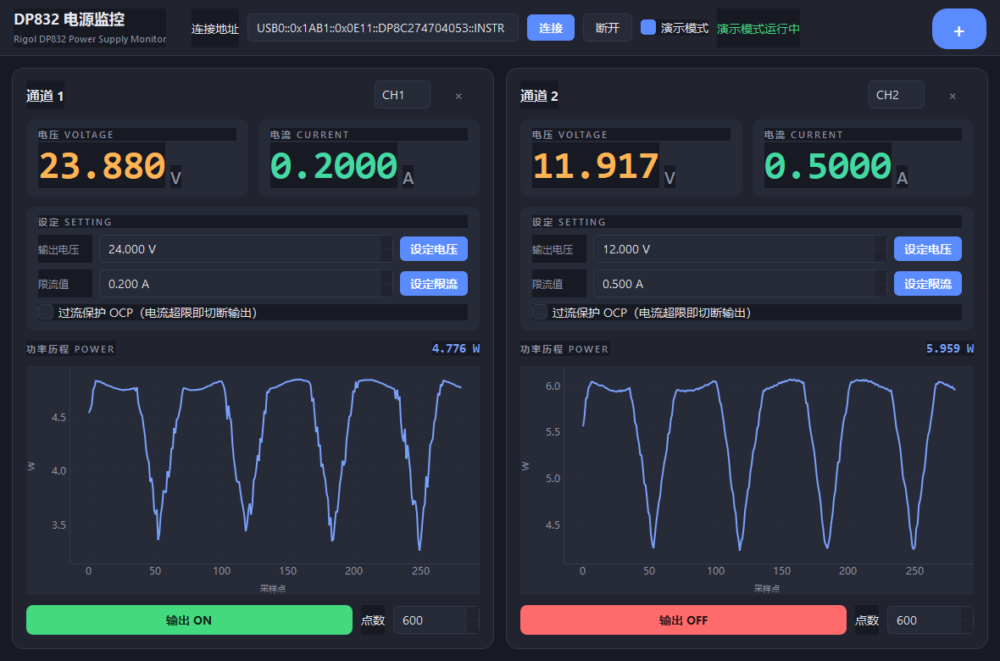

# DP832 GUI Modern

> 基于 [Colin O'Flynn 的 dp832-gui](https://github.com/coflynn/dp832-gui) 现代化改进而来的 Rigol DP832 可编程直流电源图形化监控与设置工具。

[](https://www.python.org/)
[-green)](https://pypi.org/project/PySide6/)
[](LICENSE)

`DP832 GUI Modern` 在原版基础上完成了从 **Python 2.7 + PySide(Qt4)** 到 **Python 3 + PySide6(Qt6)** 的整体移植，并重构了界面与功能：全新的卡片式深色主题、大字体电压/电流实时显示、功率历程曲线，以及**输出电压设定、限流设定与过流保护（OCP）**能力。通过 VISA（已在 USB 下测试）连接 Rigol DP832 电源。

---

## ✨ 相比原版的改进

- **技术栈现代化**：Python 2.7 + PySide(Qt4) → Python 3 + PySide6(Qt6) + pyqtgraph + pyvisa。
- **卡片式界面**：每个通道一张卡片，`+` 按钮可增加通道列（默认 1 列，最多 3 列），布局统一、可单独移除。
- **大字体读数**：电压 / 电流以醒目的大字体彩色显示，功率以实时历程曲线呈现。
- **输出参数设定**：
  - 设定输出电压（如 24V）
  - 设定恒流限流值（如 0.2A）
  - 过流保护 OCP：电流超过阈值即自动切断输出
- **演示模式**：无需连接真实设备，即可用模拟数据预览界面与设定效果（模拟恒流钳位）。
- **一键启动脚本**：提供静默启动、调试启动与依赖安装脚本（Windows）。

---

## 🖼️ 界面

新版为深色主题的卡片式布局：顶部为连接工具栏与右侧 `+` 增列按钮，主体为 1~3 个通道卡片，每张卡片包含通道选择、大字体电压/电流、设定区（电压/限流/OCP）、功率历程曲线与输出开关。



---

## 📋 环境要求

- Windows（启动脚本为 `.bat`；核心代码亦可跨平台运行）
- Python 3.10+（开发测试环境为 Python 3.14）
- VISA 运行时：Rigol **Ultra Sigma** 或 **NI-VISA**（用于识别并连接电源）
- 依赖库：见 [requirements.txt](requirements.txt)
  - PySide6、pyqtgraph、pyvisa

---

## 🚀 安装

### 方式一：Windows 一键脚本（推荐）

```bat
install.bat
```

该脚本会在项目目录创建 `.venv` 虚拟环境并安装全部依赖。

### 方式二：手动安装

```bash
python -m venv .venv
# Windows
.venv\Scripts\activate
# macOS / Linux
source .venv/bin/activate

pip install -r requirements.txt
```

---

## 🎮 使用

1. 启动程序：
   - `启动DP832GUI.bat`：静默运行（无控制台窗口）
   - `调试启动(显示错误).bat`：保留控制台，便于查看报错
   - 或直接运行：`python dp832gui/dpgui.py`
2. 在顶部填写 VISA 连接地址，形如：
   ```
   USB0::0x1AB1::0x0E11::DP8XXXXXXXX::INSTR
   ```
   > 地址可从 Rigol Ultra Sigma 或 DP832 前面板的 Utilities 菜单中获取。
3. 若暂时没有设备，可勾选 **演示模式** 后点击「连接」，用模拟数据预览。
4. 点击右侧 **`+`** 按钮增加通道列（最多 3 列）。
5. 在每张卡片的「设定」区：
   - 输入电压后点「设定电压」
   - 输入限流值后点「设定限流」
   - 勾选「过流保护 OCP」以在电流超限时切断输出
6. 点击卡片底部的 **输出 ON/OFF** 控制该通道输出。

---

## 🔧 使用的 SCPI 命令

DP800/DP832 系列先通过 `:INST:NSEL <通道号>` 选择通道，再下发设定命令。

| 功能 | 命令 | 说明 |
|------|------|------|
| 选择通道 | `:INST:NSEL 1` | 选中 CH1（1/2/3） |
| 读取电压/电流/功率 | `MEAS:ALL? CH1` | 返回 `V,I,P` |
| 设定输出电压 | `:VOLT 24` | 例：输出 24V |
| 设定恒流限流 | `:CURR 0.2` | 恒流钳位，**不切断**输出 |
| 过流保护阈值 | `:CURR:PROT:LEV 0.2` | OCP 触发电流 |
| 开/关过流保护 | `:CURR:PROT:STAT ON` | 超限**切断输出** |
| 清除保护状态 | `:CURR:PROT:CLE` | OCP 触发后需清除方可恢复输出 |
| 输出开/关 | `:OUTP CH1,ON` | 控制通道输出 |

> **限流 vs 过流保护**：`:CURR` 是恒流限制，电流达到设定值时电源自动降压维持该电流，不会断电；`:CURR:PROT` 才是真正"过流切断输出"。二者配合使用可完整实现"限流 + 过流保护"。

---

## 📁 项目结构

```
dp832-gui-modern/
├── dp832gui/
│   ├── dp832.py            # DP832 VISA 通信驱动（读数/设定电压电流/OCP）
│   └── dpgui.py            # PySide6 图形界面（卡片式布局）
├── install.bat             # 创建 .venv 并安装依赖
├── 启动DP832GUI.bat         # 静默启动
├── 调试启动(显示错误).bat    # 带控制台启动（便于排错）
├── make_shortcut.ps1       # 生成桌面快捷方式（辅助脚本）
├── requirements.txt        # Python 依赖
├── assets/
│   └── screenshot.png      # 新版界面截图
├── LICENSE                 # MIT 许可证
└── README.md
```

---

## ⚠️ 注意事项

- 远程连接期间**无法通过电源前面板控制**（一般仅能开关输出）。建议先在面板设好参数再连接；需要修改时断开连接、在面板调整后再重新连接，无需重启本程序。
- 若连接地址无效，请先用 Rigol Ultra Sigma 确认设备已被正确识别。
- 设定电压/电流/OCP 会**直接作用于真实电源**，请确认接线与负载安全后再操作。

---

## 🙏 致谢

本项目改进自 [Colin O'Flynn](https://github.com/coflynn) 的原始作品 [dp832-gui](https://github.com/coflynn/dp832-gui)，原作采用 MIT 许可证，版权归原作者所有。感谢原作者奠定的基础。

---

## 📄 许可证

本项目沿用 MIT 许可证，详见 [LICENSE](LICENSE)。
